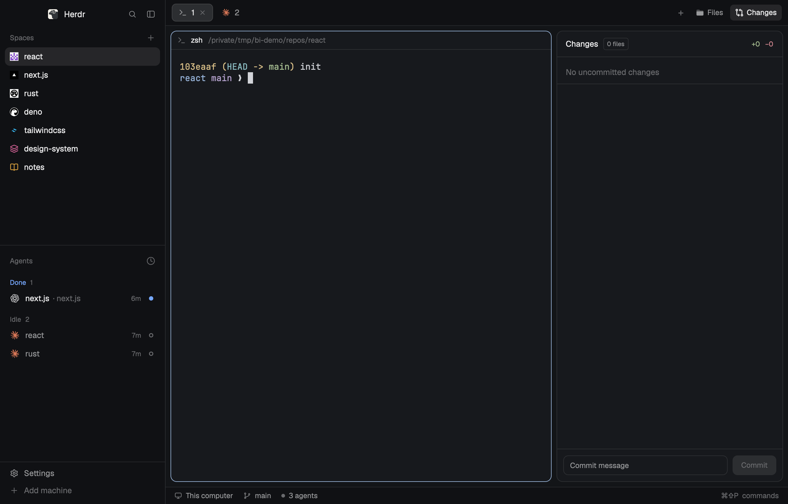
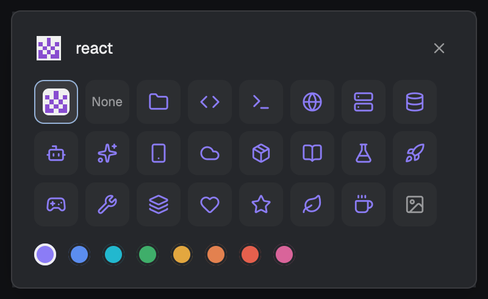

# Better Icons for Herdr

[中文](README.zh-CN.md)

Recognizable icons for [Herdr](https://herdr.dev): repository avatars for spaces, colored logos for agents, and an icon picker.



- **Repository avatars**: a space in a GitHub or GitLab repo shows its owner's avatar; otherwise no icon
- **Agent logos in color**: Claude Code, Codex, Gemini, Cursor, OpenCode, Copilot, Kimi, Kiro, Amp and more
- **Icon picker**: click a space's icon (or right-click → Icon…): Auto, None, 21 icons in 8 colors, or your own image
- The spaces list and tab bar are otherwise Herdr's own



## Install for agent

Paste this to your agent in Herdr:

```text
Install the Herdr mod at https://github.com/Umupa/herdr-better-icons:
copy mods/better-icons into ~/.config/herdr-app/mods/ and extras/main-better-icons.json
into ~/.config/herdr-app/layouts/, run herdr-app check on the mod,
then herdr-app do layout.switch --name main-better-icons.
```

## Install by hand

```sh
git clone https://github.com/Umupa/herdr-better-icons.git
cp -R herdr-better-icons/mods/better-icons ~/.config/herdr-app/mods/
cp herdr-better-icons/extras/main-better-icons.json ~/.config/herdr-app/layouts/
herdr-app do layout.switch --name main-better-icons
```

In your own layout instead, point the spaces and tab bar blocks at it:

```json
{ "id": "spaces", "type": "block", "content": { "mod": "better-icons" } }
{ "id": "tabs", "type": "block", "content": { "mod": "better-icons", "props": { "mode": "tabs" } } }
```

## Notes

- Downloads avatars from GitHub / GitLab with `curl`; runs `git` to read remotes.
- Adds agent icons to `~/.config/herdr-app/programs.json` (your own entries are left alone).
- Apache-2.0. Agent marks: LobeHub icons (MIT); brand marks belong to their owners. See [NOTICE](NOTICE).
