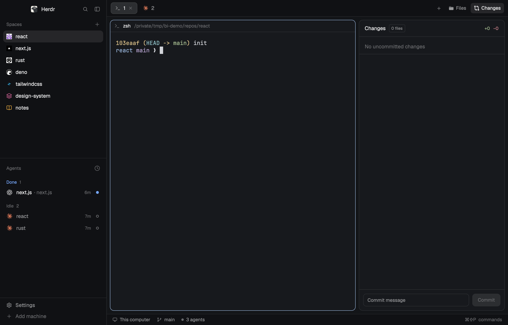
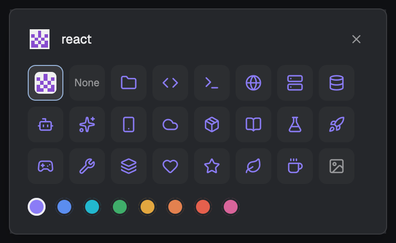

# Better Icons for Herdr

[English](README.md)

让 [Herdr](https://herdr.dev) 一眼认得出：空间显示仓库头像，agent 显示彩色 logo，还有图标选择器。



- **仓库头像**：GitHub / GitLab 仓库的空间显示所有者头像；不是仓库就不显示图标
- **彩色 agent logo**：Claude Code、Codex、Gemini、Cursor、OpenCode、Copilot、Kimi、Kiro、Amp 等
- **图标选择器**：点空间的图标（或右键 → Icon…）：自动、无、21 个图标 × 8 种颜色，或用自己的图片
- 空间列表和标签栏其余部分保持 Herdr 原样



## 让 agent 安装

把这段发给 Herdr 里的 agent：

```text
安装 Herdr mod https://github.com/Umupa/herdr-better-icons：
把 mods/better-icons 复制到 ~/.config/herdr-app/mods/，把 extras/main-better-icons.json
复制到 ~/.config/herdr-app/layouts/，用 herdr-app check 检查 mod，
再运行 herdr-app do layout.switch --name main-better-icons。
```

## 手动安装

```sh
git clone https://github.com/Umupa/herdr-better-icons.git
cp -R herdr-better-icons/mods/better-icons ~/.config/herdr-app/mods/
cp herdr-better-icons/extras/main-better-icons.json ~/.config/herdr-app/layouts/
herdr-app do layout.switch --name main-better-icons
```

用自己的布局的话，把空间列表和标签栏两块改成：

```json
{ "id": "spaces", "type": "block", "content": { "mod": "better-icons" } }
{ "id": "tabs", "type": "block", "content": { "mod": "better-icons", "props": { "mode": "tabs" } } }
```

## 说明

- 用 `curl` 从 GitHub / GitLab 下载头像；运行 `git` 读取远程地址。
- 会在 `~/.config/herdr-app/programs.json` 里加 agent 图标（你自己设过的不动）。
- Apache-2.0。Agent 标志来自 LobeHub icons（MIT），品牌标志归各自所有者。见 [NOTICE](NOTICE)。
