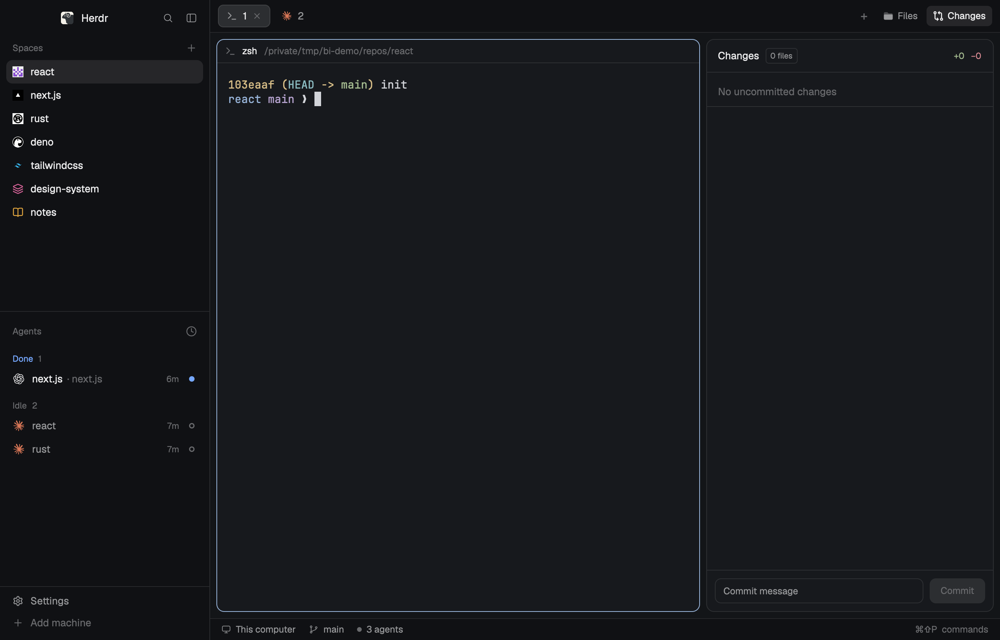

# Better Icons

Quiet, recognizable icons for Herdr: each space in the sidebar shows its git repository owner's avatar (GitHub or GitLab), or nothing; any space can instead get one of 21 glyphs in one of 8 colors, or a picture of your own; agents show their own logos in brand color; the tab bar's Files and Changes buttons get cleaner icons.

**What you see:**

- Spaces list (sidebar, top): Herdr's own spaces list, with a 14px icon before each name in place of the 18px colored letter tile. Repository owner avatars are drawn as pictures with corners rounded to 24% of their size. A glyph is a 14px Lucide icon in its color (default `#8b7cf6`). Rows without an icon keep a 14px empty slot whenever any row has one, so names line up; with no icons at all there's no slot. Worktree rows keep Herdr's branch glyph. In the narrow rail, a space with an icon shows it at 15px instead of its number.
- Agents list: unchanged mod; its icons come from `programs.json`. 15 agents point at this mod's SVGs: brand-colored (claude, gemini, antigravity, kimi, kiro, amp, qoder, muse: `tint: false`) or one-color (codex, cursor, opencode, copilot, grok, hermes, mastracode: `tint: true`). Each SVG has viewBox `-2 -2 28 28`, so it draws ~86% of the slot.
- Tab bar: Herdr's own, with Files using `icons/files.svg` (16px viewBox, solid folder with a front at full opacity and a back flap at 0.45) and Changes using Octicons' `git-compare` (16px).
- Icon dialog (overlay, `PICKER_WIDTH` = 8×36 + 7×6 + 36 + 16 = 382px wide, 228px tall, `t.popover`, padding 18): a header row (20px current icon, space name semibold, a × button), a wrapping grid of 36px tiles 6px apart, 8 per row: Auto (the avatar, or the word "Auto"), None, 21 glyphs drawn in the chosen color, Image (the chosen picture, or an image glyph). The chosen tile has a `t.accent` 1px border on `t.selected`, the others `t.raised`. Below that, 8 color dots (18px, 10px apart), the chosen one ringed in `t.foreground`. Colors: `#8b7cf6 #5b8def #22b8cf #3fae6a #e3a73f #e3814f #e5604d #d9649a`.

**How it behaves:**

- Agent statuses are Herdr's (the agents list and the space's `·`/`●` in the rail are unchanged).
- Click a space's icon: the Icon dialog opens (the row's own click, select and drag, isn't triggered). Right-click a space: a menu with Rename, Icon…, New/Open worktree (in a repo), Remove worktree (in a linked worktree), Close. `better-icons:icon` in keys.json opens the dialog for the focused space.
- In the dialog every pick applies at once and stays open. Picking a color recolors the current glyph if the space has one, and is the color for the next glyph picked. Image opens the system file picker; dropping a file on the dialog does the same. A bad file shows a red line under the colors. Esc or × closes.
- Avatars: after the spaces list reads a place's git (Herdr's own refresh), it also reads `remote.upstream.url`/`remote.origin.url`; owners on github.com/gitlab.com are downloaded one at a time to `mods/better-icons/.cache/avatars/<host>-<owner>.png` and refreshed after 7 days; a failed download is retried after an hour.
- On start, the sidebar copy merges the agent entries into `programs.json` (only entries with no `icon` or one under `mods/better-icons/`).

**Built from:**

- One mod, `mods/better-icons/`, with four roles by `props().mode`: none (the spaces list), `tabs` (the tab bar), `menu` (popup), `picker` (dialog). `main.js` swaps the instance's prototype to the role's class in `init`, so each role is the copy's root view.
- `sidebar.js`: herdr-app 0.1.15's `defaults/mods/spaces/main.js` with changes marked `better-icons` (avatar lookup in `check`, `fetchAvatars` in the 250ms `checkNew`, `menu`/`picker` opening this mod's overlays, the icon slot in `row`/`compact`). `tabbar.js`: `defaults/mods/tabs/main.js` with two icon paths changed. `menu.js`: the space part of `defaults/mods/menu/main.js` plus Icon….
- `model.js` (shared keys `better-icons.spaces` = space id → `{kind: "none"|"icon"|"image", name?, color?, path?}`, `better-icons.avatars` = owner key → `{path, at}`; remote URL parsing), `icon.js` (drawing), `files.js` (curl downloads, `file://` copies of picked images, the file picker, the `programs.json` merge), `picker.js`.
- herdr: `spaces`, `panes`, `machines`, `exec`, `hc`, `shared`/`setShared`, `openOverlay`/`closeOverlay`, `readTextFile`/`writeTextFile`, `appHome`, `window().platform`, `fetch` (GitLab API), `nextCommand`, `focused`. Commands: `space.*`, `layout.show/hide/select`, `tab.*`.
- Programs: `git`, `curl`, `osascript` / `zenity` / `kdialog` / `powershell`.
- Art: LobeHub icons (MIT), Lucide (ISC), Octicons (MIT), one original folder.

**Watch out:**

- A mod can't import another mod's files (`../spaces/main.js` resolves outside the application directory), so the spaces list and tab bar are copies, and won't pick up later fixes in Herdr's own.
- Don't render a role as a child view (`cx.new(Role)`) of the mod's root: Herdr redraws only the root on live changes, and a child tab bar never saw the panel open, so its Files button couldn't close it.
- `"transparent"` is not a color here; use `#00000000`.
- Writing a PNG into the mod folder reloads the mod; keep downloads in a hidden folder (`.cache/`).
- `image()` paths are relative to the app home; copies go under `mods/better-icons/.cache/images/`.

**Done when:**

- A space in a GitHub repository shows the owner's avatar within a few seconds; a non-git space shows no icon and its name lines up with the others.
- The Icon dialog opens from the icon and from Icon…; picking a glyph, then a color, changes the row immediately; None removes the icon; Auto brings the avatar back.
- Dropping a PNG on the dialog makes it the space's icon.
- Claude Code shows the orange mark and Codex the OpenAI mark in the agents list.
- Files opens the panel, and clicking Files again closes it.
- `herdr-app check ~/.config/herdr-app/mods/better-icons` passes.
